# 🛡️ SMS Suraksha — Multilingual Fraud SMS Detector

> **An NLP-based system for detecting spam and fraud-related SMS messages across six major Indian languages using traditional machine learning and Google's MuRIL transformer.**

SMS Suraksha is an end-to-end multilingual NLP project designed to identify suspicious SMS messages in **English, Hindi, Bengali, Urdu, Punjabi, and Marathi**.

The project covers the complete machine-learning lifecycle — from **data cleaning and exploratory analysis to feature engineering, baseline machine-learning models, transformer fine-tuning, explainability, evaluation, and deployment through a web application**.

---

## 📌 Table of Contents

* [Project Overview](#-project-overview)
* [Key Features](#-key-features)
* [Languages Supported](#-languages-supported)
* [System Architecture](#-system-architecture)
* [Project Workflow](#-project-workflow)
* [Project Structure](#-project-structure)
* [Dataset](#-dataset)
* [Phase 1 — Data Cleaning & EDA](#phase-1--data-cleaning--eda)
* [Phase 2 — Feature Engineering](#phase-2--feature-engineering)
* [Phase 3 — Baseline Models](#phase-3--baseline-models)
* [Phase 4 — MuRIL Fine-Tuning](#phase-4--muril-fine-tuning)
* [Phase 5 — Evaluation & Explainability](#phase-5--evaluation--explainability)
* [Phase 6 — Web Application](#phase-6--web-application)
* [Tech Stack](#-tech-stack)
* [Installation & Setup](#-installation--setup)
* [Running the Project](#-running-the-project)
* [Model Pipeline](#-model-pipeline)
* [Explainability](#-explainability)
* [Use Cases](#-use-cases)
* [Limitations](#-limitations)
* [Future Improvements](#-future-improvements)
* [Project Highlights](#-project-highlights)

---

# 📖 Project Overview

SMS-based scams are increasingly delivered through multilingual messages containing suspicious links, payment requests, fake rewards, KYC requests, impersonation attempts, and urgent financial instructions.

Most SMS classification systems are developed primarily for English. **SMS Suraksha focuses on multilingual SMS detection across six Indian languages**, combining traditional NLP techniques with a transformer model specifically designed for Indian languages.

The project follows a staged pipeline:

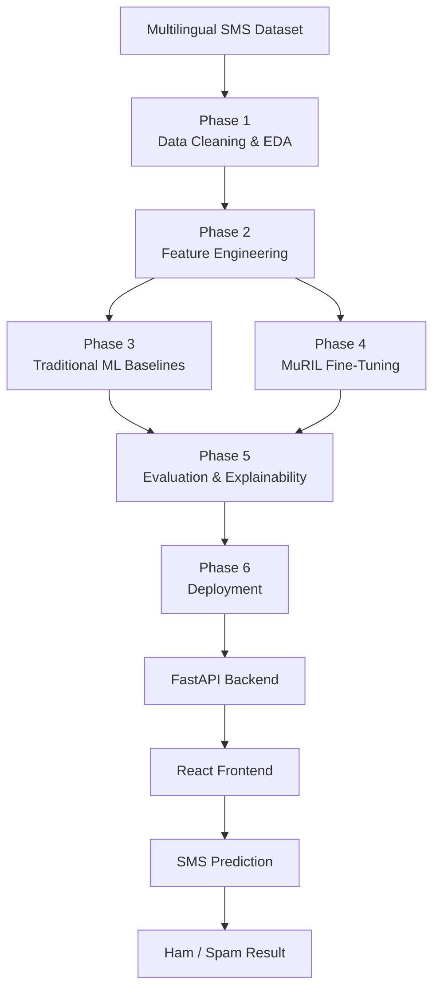

---

# ✨ Key Features

* 🌐 **Multilingual SMS classification**
* 🇮🇳 Support for six Indian languages
* 🧹 Automated data cleaning and preprocessing
* 📊 Exploratory Data Analysis
* 🔤 TF-IDF-based feature representation
* 🤖 Multiple traditional ML baseline models
* 🧠 Fine-tuned **Google MuRIL** transformer
* 🔎 LIME-based model explainability
* 📈 Confusion matrix and per-language evaluation
* 🚀 FastAPI inference backend
* 💻 React-based demonstration interface
* ⚡ Real-time SMS classification through the web application

---

# 🌐 Languages Supported

| Language | Code |
| -------- | ---- |
| English  | `en` |
| Hindi    | `hi` |
| Bengali  | `bn` |
| Urdu     | `ur` |
| Punjabi  | `pa` |
| Marathi  | `mr` |

The project filters the original multilingual dataset to focus specifically on these six Indian languages.

---

# 🏗️ System Architecture

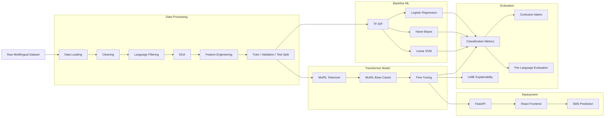

---

# 🔄 Project Workflow

The project is divided into six phases:

| Phase       | Objective                               | Main Output                             |
| ----------- | --------------------------------------- | --------------------------------------- |
| **Phase 1** | Data cleaning & EDA                     | `cleaned_sms_dataset.csv`               |
| **Phase 2** | Feature engineering & dataset splitting | `train.csv`, `val.csv`, `test.csv`      |
| **Phase 3** | Traditional ML baselines                | Trained `.pkl` models                   |
| **Phase 4** | MuRIL fine-tuning                       | `muril_fraud_model/`                    |
| **Phase 5** | Evaluation & explainability             | Reports, predictions, LIME explanations |
| **Phase 6** | Deployment                              | FastAPI + React application             |

---

# 📂 Project Structure

```text
SMS-Suraksha/
│
├── phase1/
│   ├── cleaned_sms_dataset.csv
│   ├── phase1_eda_cleaning.py
│   ├── phase1_report.txt
│   └── eda_plots/
│       ├── class_balance.png
│       ├── language_distribution.png
│       ├── message_length_dist.png
│       └── spam_ratio_by_language.png
│
├── phase2/
│   ├── feature_summary.txt
│   ├── phase2_feature_engineering.py
│   ├── train.csv
│   ├── val.csv
│   ├── test.csv
│   ├── tfidf_vectorizer.pkl
│   └── eda_plots/
│       ├── feature_correlation.png
│       ├── indian_lang_distribution.png
│       ├── indian_lang_spam_ratio.png
│       └── message_length_distribution.png
│
├── phase3/
│   ├── baseline_results.txt
│   ├── phase3_baseline_model.py
│   ├── models/
│   │   ├── logistic_regression.pkl
│   │   ├── naive_bayes.pkl
│   │   └── linear_svm.pkl
│   └── eda_plots/
│       ├── baseline_confusion_matrix.png
│       └── model_comparison.png
│
├── phase4/
│   ├── phase4_transformer_finetune.py
│   ├── transformer_results.txt
│   ├── transformer_results_10k.txt
│   ├── muril_fraud_model/
│   ├── muril_fraud_model_10k/
│   ├── muril_checkpoints/
│   └── muril_checkpoints_10k/
│
├── phase5/
│   ├── phase5_evaluation_explainability.py
│   ├── phase5_evaluation_report.txt
│   ├── phase5_test_predictions.csv
│   ├── lime_explanations.txt
│   └── eda_plots/
│       ├── final_confusion_matrix.png
│       └── per_language_accuracy.png
│
├── phase6/
│   ├── backend/
│   │   ├── main.py
│   │   └── requirements.txt
│   │
│   └── frontend/
│       ├── index.html
│       ├── package.json
│       ├── package-lock.json
│       ├── vite.config.js
│       └── src/
│           ├── App.jsx
│           ├── App.css
│           └── main.jsx
│
└── README.md
```

---

# 📊 Dataset

The project uses:

**SMS Spam Multilingual Collection Dataset**

Dataset source:

[Hugging Face — SMS Spam Multilingual Collection Dataset](https://huggingface.co/datasets/dbarbedillo/SMS_Spam_Multilingual_Collection_Dataset)

The original dataset contains multilingual SMS messages. The project filters the dataset to the following Indian languages:

* English
* Hindi
* Bengali
* Urdu
* Punjabi
* Marathi

### Dataset Processing

The data pipeline performs:

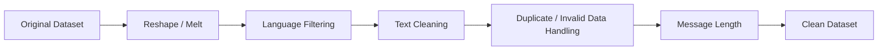

The resulting dataset is used throughout the subsequent phases.

---

# 🧹 Phase 1 — Data Cleaning & EDA

### Objective

Prepare the multilingual SMS dataset for machine-learning experiments.

### Main operations

* Load the Hugging Face dataset
* Reshape the multilingual dataset
* Convert the data into a long format
* Filter the six target Indian languages
* Clean SMS text
* Handle missing/invalid values
* Analyze class distribution
* Analyze language distribution
* Analyze message length
* Compare spam ratios across languages

### Script

```text
phase1/phase1_eda_cleaning.py
```

### Output

```text
cleaned_sms_dataset.csv
```

### Visualizations

* Class balance
* Language distribution
* Message length distribution
* Spam ratio by language

---

# 🧩 Phase 2 — Feature Engineering

### Objective

Transform the cleaned SMS data into features suitable for machine-learning models.

The phase generates:

* Message-level features
* Message length information
* Language-based analysis
* TF-IDF representation
* Train/validation/test datasets

### Script

```text
phase2/phase2_feature_engineering.py
```

### Generated files

```text
train.csv
val.csv
test.csv
tfidf_vectorizer.pkl
feature_summary.txt
```

### Dataset flow

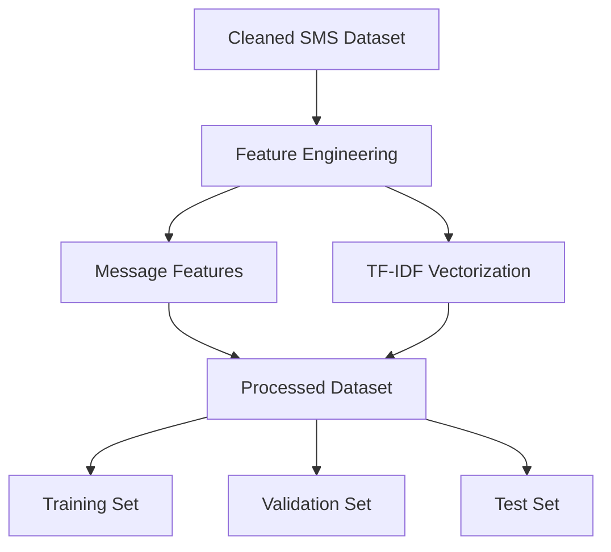

---

# 🤖 Phase 3 — Baseline Models

Before fine-tuning a transformer, traditional machine-learning models are trained to establish baseline performance.

### Models

1. **Logistic Regression**
2. **Naive Bayes**
3. **Linear SVM**

### Pipeline

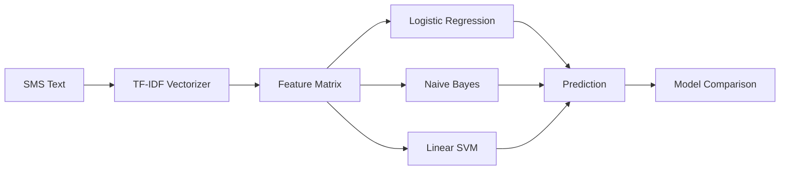

### Script

```text
phase3/phase3_baseline_model.py
```

### Outputs

```text
phase3/models/
├── logistic_regression.pkl
├── naive_bayes.pkl
└── linear_svm.pkl
```

Evaluation results are stored in:

```text
baseline_results.txt
```

---

# 🧠 Phase 4 — MuRIL Fine-Tuning

The primary transformer model used in this project is:

```text
google/muril-base-cased
```

**MuRIL — Multilingual Representations for Indian Languages** — is designed for Indian-language NLP and supports both native scripts and transliterated text.

This makes it suitable for a project focused on multilingual Indian SMS classification.

### Transformer Pipeline

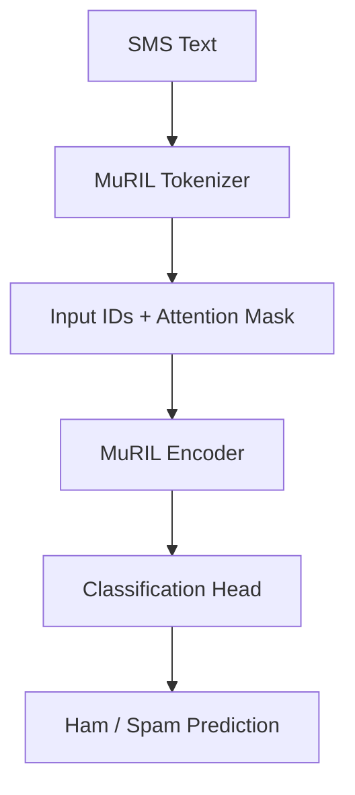

### Fine-tuning process

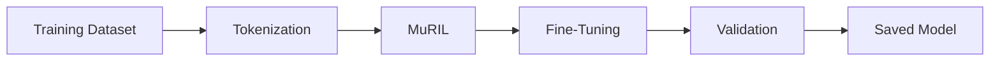

### Script

```text
phase4/phase4_transformer_finetune.py
```

### Model output

```text
phase4/muril_fraud_model/
```

The repository also contains training checkpoints and an additional experimental model directory.

---

# 🔍 Phase 5 — Evaluation & Explainability

The final model is evaluated using multiple perspectives rather than relying on a single metric.

### Evaluation includes

* Classification performance
* Confusion matrix
* Per-language performance
* Test-set predictions
* LIME explanations

### Evaluation pipeline

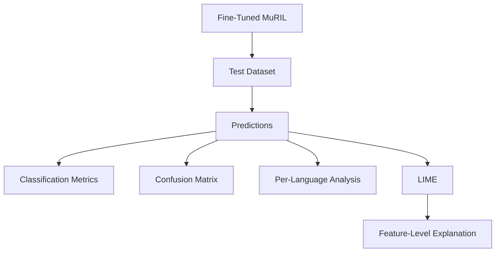

### Outputs

```text
phase5/
├── phase5_evaluation_report.txt
├── phase5_test_predictions.csv
├── lime_explanations.txt
└── eda_plots/
    ├── final_confusion_matrix.png
    └── per_language_accuracy.png
```

---

# 💡 Explainability with LIME

A major objective of SMS Suraksha is not only to classify an SMS but also to investigate **why the model produced a particular prediction**.

LIME is used to generate local explanations for individual SMS predictions.

Conceptually:

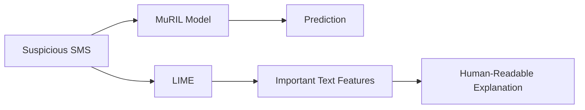

This provides an additional interpretability layer for the model's decisions.

---

# 🚀 Phase 6 — Web Application

The trained model is exposed through a **FastAPI backend** and connected to a **React frontend**.

### Application architecture

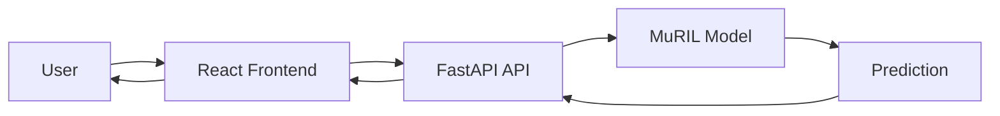

### Backend

Location:

```text
phase6/backend/
```

Main file:

```text
main.py
```

The API accepts SMS text and returns the classification result.

### Frontend

Location:

```text
phase6/frontend/
```

Built using:

* React
* Vite
* CSS

---

# 🛠️ Tech Stack

### Programming

* Python
* JavaScript

### Data Processing

* Pandas
* NumPy
* Hugging Face Datasets

### Machine Learning

* Scikit-learn
* Logistic Regression
* Naive Bayes
* Linear SVM
* TF-IDF

### Deep Learning / NLP

* PyTorch
* Hugging Face Transformers
* MuRIL

### Explainability

* LIME

### Backend

* FastAPI
* Uvicorn

### Frontend

* React
* Vite
* CSS

### Visualization

* Matplotlib

---

# ⚙️ Installation & Setup

## Requirements

Recommended:

```text
Python 3.10+
Node.js
npm
Git
```

A CUDA-compatible NVIDIA GPU is recommended for transformer fine-tuning, although the baseline models can run without a GPU.

---

# ▶️ Running the Project

## Phase 1

```bash
cd phase1

pip install datasets pandas matplotlib langdetect

python phase1_eda_cleaning.py
```

This generates:

```text
cleaned_sms_dataset.csv
```

Copy the generated dataset into `phase2/`.

---

## Phase 2

```bash
cd ../phase2

pip install scikit-learn pandas matplotlib joblib

python phase2_feature_engineering.py
```

Generates:

```text
train.csv
val.csv
test.csv
tfidf_vectorizer.pkl
```

---

## Phase 3

```bash
cd ../phase3

pip install scikit-learn pandas matplotlib joblib scipy

python phase3_baseline_model.py
```

Generates the baseline model files under:

```text
models/
```

---

## Phase 4

For transformer fine-tuning:

```bash
cd ../phase4

pip install transformers datasets torch scikit-learn accelerate

python phase4_transformer_finetune.py
```

### GPU recommendation

Check whether PyTorch detects CUDA:

```python
import torch

print(torch.cuda.is_available())

if torch.cuda.is_available():
    print(torch.cuda.get_device_name(0))
```

---

## Phase 5

```bash
cd ../phase5

pip install lime transformers torch scikit-learn matplotlib pandas

python phase5_evaluation_explainability.py
```

---

# 🌐 Running the Application

## Backend

```bash
cd phase6/backend

pip install -r requirements.txt

uvicorn main:app --reload --port 8000
```

The API will normally be available at:

```text
http://localhost:8000
```

FastAPI documentation:

```text
http://localhost:8000/docs
```

---

## Frontend

Open another terminal:

```bash
cd phase6/frontend

npm install

npm run dev
```

Open the local URL shown by Vite, typically:

```text
http://localhost:5173
```

---

# 🔁 End-to-End Prediction Flow

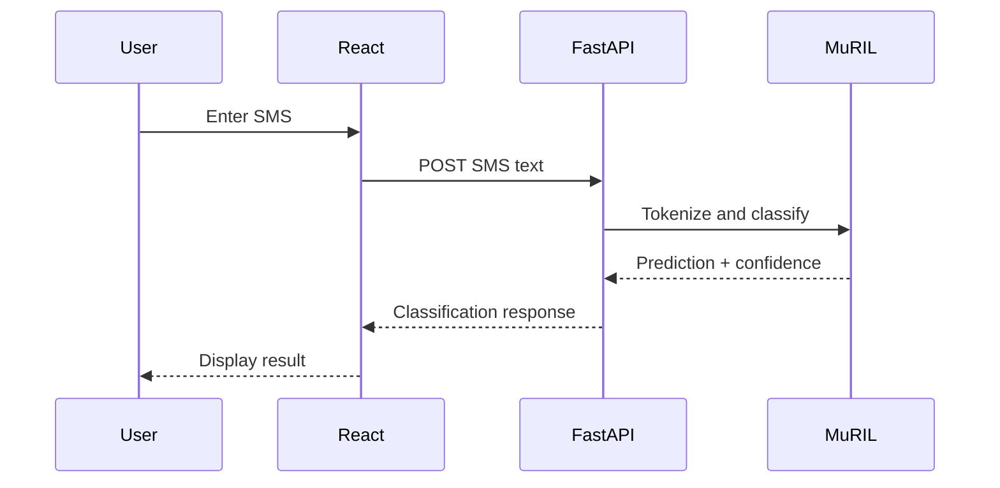

---

# 🧪 Model Development Strategy

The project uses a two-level modeling strategy.

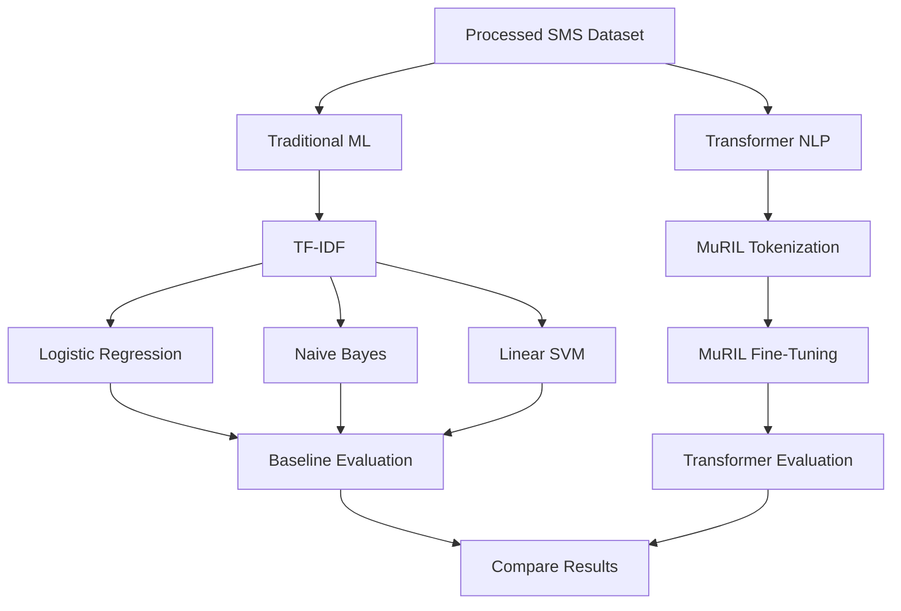

This approach provides a baseline using conventional NLP methods before moving to a language-model-based approach.

---

# 🎯 Use Cases

### 1. Telecom SMS Filtering

Potential integration with SMS gateways to identify suspicious messages before delivery.

### 2. Banking Fraud Alerts

Banks and financial applications could analyze messages containing:

* KYC requests
* Payment instructions
* Suspicious links
* Account-related impersonation

### 3. User Protection

A consumer-facing application could help users identify potentially suspicious SMS messages.

### 4. Regional Fraud Analysis

The multilingual dataset enables analysis of spam patterns across different Indian languages.

### 5. Explainable SMS Detection

Users can submit an SMS and receive a classification through the web application.

---

# ⚠️ Limitations

### Dataset limitations

The non-English portions of the dataset are machine-translated rather than necessarily being authored by native speakers.

Therefore, performance on naturally written Indian-language SMS may differ from performance on the experimental dataset.

### Code-mixed language

Real-world Indian SMS frequently contains:

* Hinglish
* English + Hindi
* Transliteration
* Regional-language + English combinations

These patterns may not be fully represented in the dataset.

### Fraud vs Spam

The project uses a **binary ham/spam classification task**.

The term "fraud SMS" is used in the application context, but the dataset does not provide a separately annotated fraud category.

Additional fraud-related signals such as:

* URLs
* urgency
* payment references
* UPI mentions
* financial terminology

can be incorporated as supporting signals, but they should not be interpreted as a separate ground-truth fraud label.

### Generalization

Model performance on this dataset does not guarantee performance on live telecom traffic or newly emerging scam patterns.

---

# 🔮 Future Improvements

Potential future improvements include:

* Native-speaker-validated multilingual datasets
* Larger Indian-language SMS datasets
* Hinglish and code-mixed SMS support
* Dedicated fraud-category annotations
* More sophisticated fraud-intent classification
* URL reputation analysis
* Sender/domain reputation analysis
* Real-time threat intelligence integration
* Model quantization for faster inference
* Mobile application deployment
* Continuous model retraining
* Adversarial robustness testing
* More advanced explainability techniques
* Comparison with XLM-R and other multilingual transformers

---

# 📈 Possible Future Model Comparison

MuRIL is currently used as the primary transformer model because of its focus on Indian languages.

For future experimentation, the project can be extended to compare:

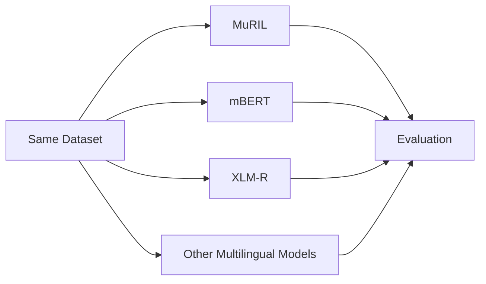

This would allow the effect of different multilingual pretrained representations to be studied under the same experimental setup.

---

# 📁 Important Files

| File                                  | Purpose                                     |
| ------------------------------------- | ------------------------------------------- |
| `phase1_eda_cleaning.py`              | Dataset loading, cleaning and EDA           |
| `phase2_feature_engineering.py`       | Feature engineering and dataset preparation |
| `phase3_baseline_model.py`            | Traditional ML model training               |
| `phase4_transformer_finetune.py`      | MuRIL fine-tuning                           |
| `phase5_evaluation_explainability.py` | Evaluation and LIME                         |
| `phase6/backend/main.py`              | FastAPI inference API                       |
| `phase6/frontend/src/App.jsx`         | React application                           |
| `phase6/frontend/src/main.jsx`        | React entry point                           |
| `README.md`                           | Project documentation                       |

---

# 🧠 Key Project Contributions

SMS Suraksha combines several components into a single end-to-end pipeline:

```text
Multilingual Dataset
        ↓
Data Cleaning
        ↓
Exploratory Data Analysis
        ↓
Feature Engineering
        ↓
Traditional ML Baselines
        ↓
MuRIL Transformer Fine-Tuning
        ↓
Model Evaluation
        ↓
LIME Explainability
        ↓
FastAPI Deployment
        ↓
React Web Application
```

The project therefore demonstrates practical experience across **data preprocessing, NLP, machine learning, transformer fine-tuning, model evaluation, explainable AI, backend API development, and frontend integration**.

---

# 👨‍💻 Project Status

| Component            | Status      |
| -------------------- | ----------- |
| Data preprocessing   | ✅ Completed |
| Exploratory analysis | ✅ Completed |
| Feature engineering  | ✅ Completed |
| Baseline ML models   | ✅ Completed |
| MuRIL fine-tuning    | ✅ Completed |
| Model evaluation     | ✅ Completed |
| LIME explainability  | ✅ Completed |
| FastAPI backend      | ✅ Completed |
| React frontend       | ✅ Completed |

---

# 📜 Disclaimer

This project is developed for **academic, research, and demonstration purposes**.

A model prediction should not be treated as definitive proof that an SMS is fraudulent. Production deployment would require additional validation, continuously updated data, security controls, and domain-specific evaluation.

---

# ⭐ Project

**SMS Suraksha — Multilingual Fraud SMS Detector**

> Detect. Explain. Protect.

---
